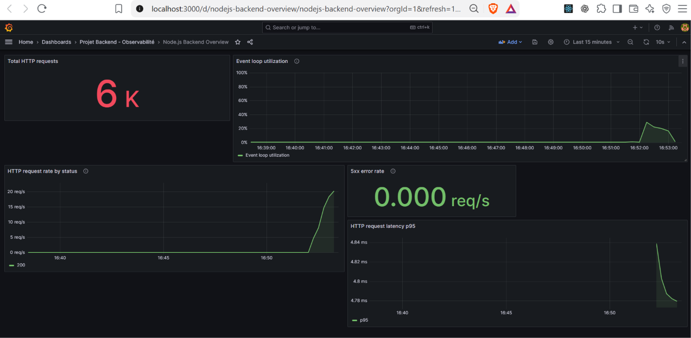
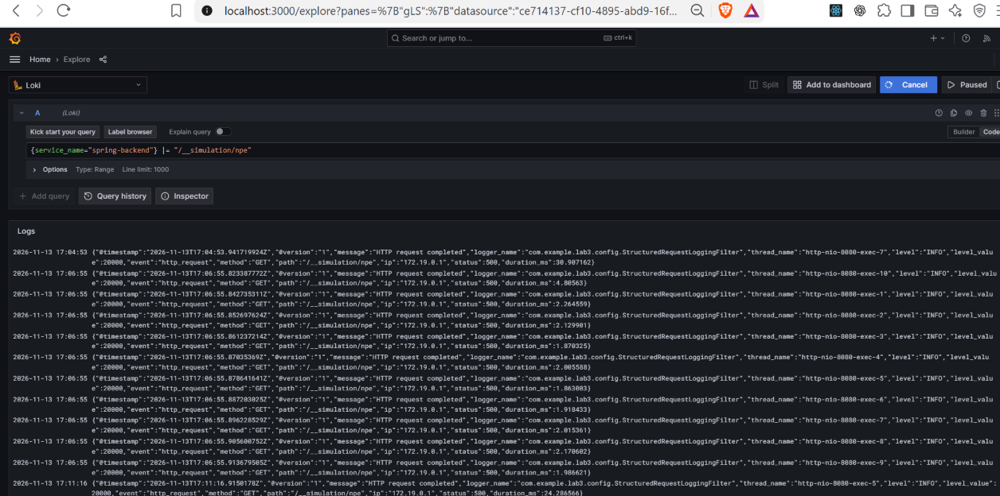
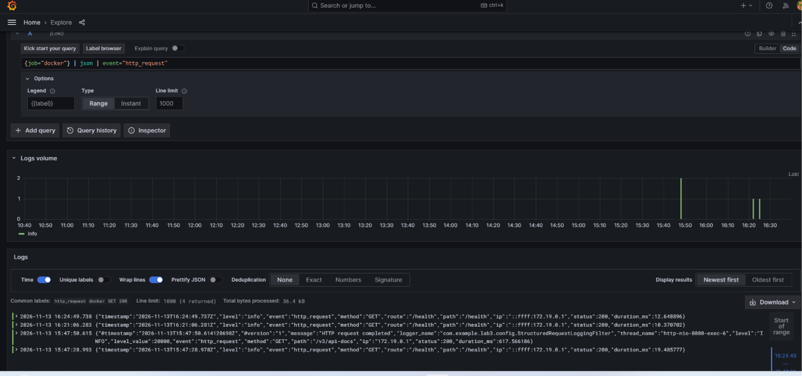
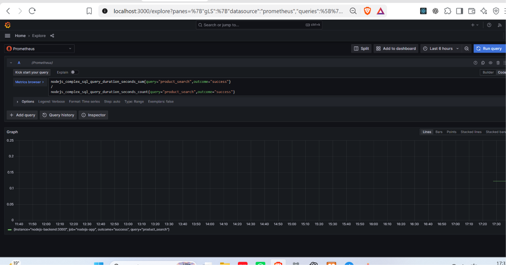

# TP14 — Observabilité des API backend

Ce rendu rassemble les applications Spring Boot, Express et Laravel avec Prometheus, Grafana, Loki, Alloy et Tempo. L’archive `rendu-laboratoire.zip` contient les quatre livrables listés ci-dessous.

## Livrables

1. `01-code-source.zip` — sources des trois applications, dépendances déclarées et fichiers de verrouillage.
2. `02-docker-compose.yml` — orchestration de la pile.
3. `03-prometheus-grafana.zip` — configuration Prometheus, dashboards Grafana JSON et configuration de l’observabilité.
4. Ce README et les captures du dossier `captures/`.

## Démarrage

Prérequis : Docker Desktop avec Docker Compose, et une connexion Internet pour récupérer les images et dépendances lors du premier build. Les services s’exécutent dans des conteneurs ; les outils Java, Node.js et PHP ne sont pas requis sur l’hôte.

Depuis la racine du dépôt, dans PowerShell :

```powershell
Copy-Item .\rendu\.env.example .\.env
docker compose up -d --build
docker compose ps
```

Les valeurs du fichier `.env.example` sont destinées à un environnement local de TP seulement. Remplacez les mots de passe et clés avant toute exposition hors de votre machine.

| Service | Adresse locale | Endpoint de métriques / santé |
| --- | --- | --- |
| Spring Boot | `http://localhost:8080` | `/actuator/prometheus` |
| Express / Node.js | `http://localhost:3001` | `/metrics` |
| Laravel | `http://localhost:8000` | `/metrics` |
| Prometheus | `http://localhost:9090` | `/targets` |
| Grafana | `http://localhost:3000` | identifiant `admin`, mot de passe défini dans `.env` |
| Loki | `http://localhost:3100` | `/ready` |
| Tempo | `http://localhost:3200` | `/ready` ; OTLP gRPC `4317`, OTLP HTTP `4318` |
| Récepteur webhook local | `http://localhost:8088` | événements reçus visibles dans ses logs Docker |

Grafana est préconfiguré avec Prometheus, Loki et Tempo. Les dashboards sont dans le dossier **Projet Backend - Observabilité**. Les URL telles que `http://prometheus:9090` et `http://loki:3100` sont les adresses internes réservées aux conteneurs ; dans le navigateur, utilisez `localhost`.

## Scénarios et requêtes utiles

### Charge Node.js

Le scénario k6 `monitoring/k6/nodejs-load.js` vise `/health` à 100 requêtes/s pendant une minute. Pour le lancer depuis PowerShell :

```powershell
$network = docker network ls --filter label=com.docker.compose.network=monitoring-net --format "{{.Name}}"
$mount = "$($PWD.Path)\monitoring\k6:/scripts:ro"
docker run --rm --network $network --volume $mount grafana/k6:latest run /scripts/nodejs-load.js
```

Le dashboard Node.js affiche le taux HTTP par statut et le p95 de latence. Pour l’exercice SQL, la route de recherche produits nécessite `Authorization: Bearer <API_KEY>` :

```powershell
$headers = @{ Authorization = "Bearer $env:API_KEY" }
Invoke-WebRequest "http://localhost:3001/api/products/search?minPrice=0&maxPrice=1000&limit=10&offset=0" -Headers $headers
```

PromQL pour le p95 d’exécution SQL :

```promql
histogram_quantile(0.95, sum by (le) (rate(nodejs_complex_sql_query_duration_seconds_bucket{query="product_search",outcome="success"}[5m])))
```

### Journaux et traces

Dans Grafana → **Explore**, choisissez Loki et exécutez :

```logql
{service_name="spring-backend"} |= "/__simulation/npe"
```

La route NPE utilisée pour la simulation était temporaire et a été retirée après la validation. Les lignes restent dans Loki jusqu’à expiration de la rétention. Dans Explore → Tempo, utilisez la source Tempo pour rechercher les traces Node.js.

### Alertes

- **HTTP 5xx** : taux agrégé supérieur à 5 % sur cinq minutes.
- **Mémoire heap JVM** : ratio heap utilisé / heap maximal supérieur à 85 % pendant deux minutes ; sévérité `critical`.
- Les deux règles utilisent le contact point **Local Webhook**. Les livraisons reçues sont consultables avec `docker compose logs -f alert-sink`.

Pour tester l’alerte mémoire sans augmenter artificiellement la mémoire JVM, abaissez temporairement le seuil `0.85` à une valeur inférieure au ratio actuel dans `monitoring/grafana/provisioning/alerting/spring-heap-memory-alert.yml`, redémarrez Grafana, attendez le délai `for: 2m`, puis restaurez `0.85` et redémarrez Grafana. La capture incluse identifie explicitement ce test par seuil temporaire.

Pour vérifier la disponibilité Laravel :

```promql
up{job="laravel-app"}
```

Après l’arrêt du conteneur, la valeur attendue est `0`. Pour le remettre en marche : `docker compose start laravel-backend`.

## Captures de validation

Les captures ci-dessous documentent les journaux associés à la simulation HTTP 500, la disponibilité de Laravel dans Prometheus, les métriques sous charge et l’histogramme SQL. La règle Grafana mémoire est livrée dans `monitoring/grafana/provisioning/alerting/spring-heap-memory-alert.yml` ; son seuil permanent est de 85 % pendant 2 minutes.

### Logs Spring HTTP 500 dans Loki



### Disponibilité Laravel dans Prometheus



### Charge de l’API Node.js



### Histogramme SQL personnalisé



## Arrêt

```powershell
docker compose down
```

Cette commande conserve les volumes. N’ajoutez `-v` que si vous souhaitez également supprimer les données persistées de MySQL, Prometheus, Loki, Tempo et Grafana.
